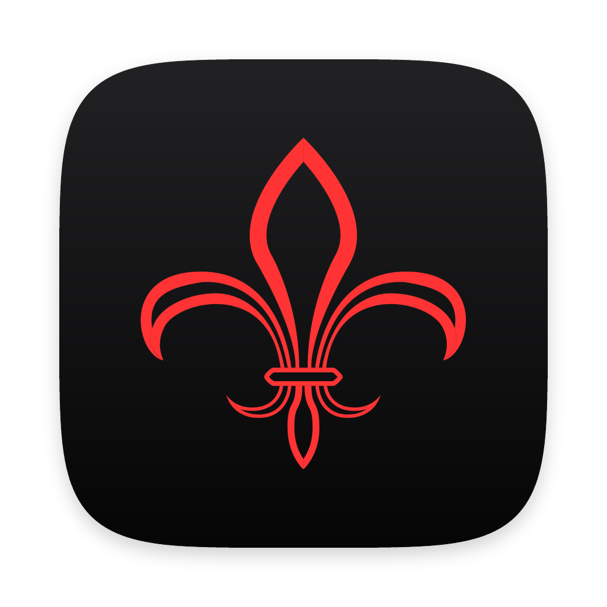

<p align="center">
  
</p>

<h1 align="center">IMP Criativos</h1>

<p align="center">App para Mac que remove a marca de criativos de <b>cassino online e bet (apostas esportivas)</b> e gera variações em lote com IA (Gemini ou GPT).</p>

<p align="center">
  <a href="https://github.com/marcelolucas11/imp-criativos/releases/download/mac/IMP-Criativos.dmg">
    
  </a>
</p>

---

## Para quem é

O IMP Criativos é feito **somente para criativos de cassino online e apostas esportivas (bet)** de operadores autorizados no Brasil.
Cassino aqui é sempre **online** (jogos de celular, com personagens e símbolos em 3D), nunca cassino físico.
Todos os prompts das IAs partem desse contexto (`Sources/IMPCriativos/Models/Niche.swift`): o mesmo jogo ou esporte e o mesmo
personagem 3D são mantidos, nenhuma odd, multiplicador, valor, bônus ou promessa de ganho é inventado, e os avisos
**18+** e de **jogo responsável** seguem a opção em Configurações → *Avisos do criativo* (de fábrica, o app remove; ligada, mantém).
Não é um app de uso geral nem para rifas ou sorteios.

## O que faz

1. **Lê uma pasta** de criativos (JPG, PNG, WEBP, HEIC).
2. **Limpa** cada criativo: remove logo, nome da empresa, @, site, telefone, CNPJ — a lista é editável por cliente.
   - **Limpar logo** (menu lateral): módulo só de limpeza, para anúncios pegos na Biblioteca de Anúncios. Remove o logo e o nome da empresa, confere e baixa os limpos (`cliente_criativo_limpo.jpg`), no tamanho original ou nos verticais do Meta. Não cria variações.
   - **Limpeza desligada:** no Novo lote, desligue "Limpar logo e nome antes das variações" quando as imagens já vierem limpas; elas vão direto para as variações, sem custo de limpeza.
3. **Confere** a limpeza e transcreve o texto do criativo.
4. **Gera N variações** de cada um, cada uma num **eixo de variação** diferente, mantendo o texto exato. O app já vem com **50 eixos de cassino e bet** ([lista](docs/EIXOS-DE-VARIACAO.md)), usados em rodízio pelos criativos do lote: cada variação sai com cara de peça nova, sem fugir do jogo ou esporte do original.
   - **Teste de eixos:** coloque uma imagem e o app gera uma variação para cada eixo marcado no cliente (até os 50), com o número e o nome do eixo em cada arquivo, para comparar os estilos.
   - **Rápido e seguro:** as variações saem em paralelo e o app aumenta sozinho os pedidos ao mesmo tempo enquanto a IA responde bem; ao primeiro sinal de risco, volta para a velocidade original.
   - **Instruções por lote (opcional):** no Novo lote, escreva em texto livre o que quer (ex.: "tirar todo nome Aviator, adicionar o nome Y, ângulos bem variados"). O app separa em *remover*, *alterar texto* e *direção das variações*, mostra para você conferir e aplica cada parte na etapa certa.
5. **Confere o texto** de cada variação e marca divergências.
6. **Fila de revisão**: aprovar, refazer (com observação) ou descartar.
7. **Baixa os aprovados** nos tamanhos verticais padrão do Meta Ads: 1080×1350 (feed 4:5) ou 1080×1920 (stories e reels 9:16).

Exemplo: 50 criativos × 4 variações = **50 limpos + 200 variações**.

### Otimizador em Lote (Stories 9:16) — sem IA

Aba própria no menu lateral (também no Início, na barra de menus e em ⇧⌘O). Roda **100% no Mac**: sem internet, sem chave de API e sem custo.

- Arraste até **100 imagens** (JPG, PNG, WebP, HEIC) ou uma pasta; miniaturas com status, remover item ou limpar tudo.
- **Enquadramento 9:16 (1080×1920):** Preencher (corta o excesso), Fundo desfocado (imagem inteira + cópia desfocada em cima e embaixo) ou Cor sólida (preto, cor dominante ou cor escolhida).
- **Limpeza de metadados:** cada imagem é redesenhada do zero; EXIF, IPTC, XMP, GPS, comentários e perfis antigos não passam. O arquivo sai só com perfil sRGB.
- **Variações sorteadas por imagem**, em cinco níveis: Leve, Moderado, Normal, Agressivo e Personalizado. Os ajustes:
  - micro-recorte e rotação (Moderado: 0,5–1,5% e ±0,8°; Agressivo: até 5% e ±2°) e micro-perspectiva;
  - brilho, contraste e saturação, e temperatura de cor;
  - micro-ruído e **riscos diagonais pixel a pixel** (uma linha escurece, a seguinte clareia, a outra mantém o tom original);
  - deslocamento de 1px ou 2px no canal R ou B e granulação de filme;
  - vinheta e Unsharp Mask leve ou suavização;
  - espelhar (desligado de fábrica; só para imagens sem texto).
- **Texturas, linhas e bordas** (opcional, desligado de fábrica; presets Sutil, Equilibrado, Intenso e Personalizado, cada efeito com slider de 0 a 100%): linhas diagonais bem marcadas (\\, /, X ou aleatória; espessura de 2 a 8px, espaçamento de 4 a 18px, faixa escura com realce claro, mistura hard-light/overlay e fase aleatória por imagem), serrilhado só nas bordas de alto contraste, aberração cromática RGB (1 a 6px) e ofuscação com bloom.
- **Versões por imagem (1 a 10):** cada versão sai com um sorteio diferente (`story_001_v2_a8f3k.jpg`).
- **Gravação:** JPEG pela libjpeg-turbo com qualidade 88–93, baseline ou progressivo e subamostragem 4:2:0 ou 4:4:4 sorteados; ou PNG. Nomes `story_001_a8f3k.jpg` (ou só sequenciais).
- **Antes / Depois** da imagem selecionada com as configurações atuais (é exatamente o arquivo que vai sair) e "Novo sorteio".
- **Inspecionar Antes / Depois:** janela grande com cortina arrastável ou lado a lado, zoom 100% / 200% / 400% com arrastar e "Re-randomizar Preview", para conferir o serrilhado, as linhas e o deslocamento RGB direto nas letras antes de processar o lote.
- **Fila** com 4 imagens por vez, barra "X de Y", status por arquivo e Cancelar. Salva numa pasta `stories_data_hora` dentro da pasta escolhida e oferece **Baixar Tudo (.ZIP)**.

## Instalar

1. Clique em **Baixar para Mac** acima (ou baixe o `.dmg` de qualquer versão em [Releases](../../releases)).
2. Arraste o **IMP Criativos** para **Aplicativos**.
3. Na primeira vez: **clique direito no app → Abrir → Abrir**.
   (Ou Ajustes do Sistema → Privacidade e Segurança → "Abrir Mesmo Assim".)
4. Em **Configurações → Chaves de API**, cole sua chave do Gemini e/ou da OpenAI.

Requisitos: macOS 14 (Sonoma) ou superior, Mac com Apple Silicon (M1 em diante).

Guia completo: [docs/INSTALACAO.md](docs/INSTALACAO.md)

## Atualizar

Dentro do app: **Configurações → Atualizações → Buscar atualização → Instalar e reiniciar**.
O app baixa a versão nova daqui do GitHub, confere a integridade e se substitui.

## Privacidade

- **Chaves de API**: arquivo `chaves.json` do app, legível só pela sua conta do Mac. Nunca saem dele (exceto para o próprio Google/OpenAI).
- **Perfis de clientes, lotes e imagens**: `~/Library/Application Support/IMP Criativos/` e as pastas que você escolher.
- **Este repositório** contém só código e prompts genéricos. Nenhum dado de cliente.

## Para desenvolvedores

Arquitetura: [docs/ARQUITETURA.md](docs/ARQUITETURA.md) · Histórico: [CHANGELOG.md](CHANGELOG.md)

```bash
brew install xcodegen cmake
scripts/build_libjpeg_turbo.sh   # libjpeg-turbo estática para o Otimizador em Lote (só na primeira vez)
xcodegen generate
open IMPCriativos.xcodeproj
```

Publicar versão: escreva a seção no `CHANGELOG.md`, troque o número no arquivo `VERSION` (ex.: `1.0.0-beta.2`) e envie para a `main`. O GitHub Actions compila, cria a tag e publica a Release.

### Créditos

O Otimizador em Lote usa a [libjpeg-turbo](https://libjpeg-turbo.org) (licenças BSD e IJG). *This software is based in part on the work of the Independent JPEG Group.*

© 2026 Impera Services
